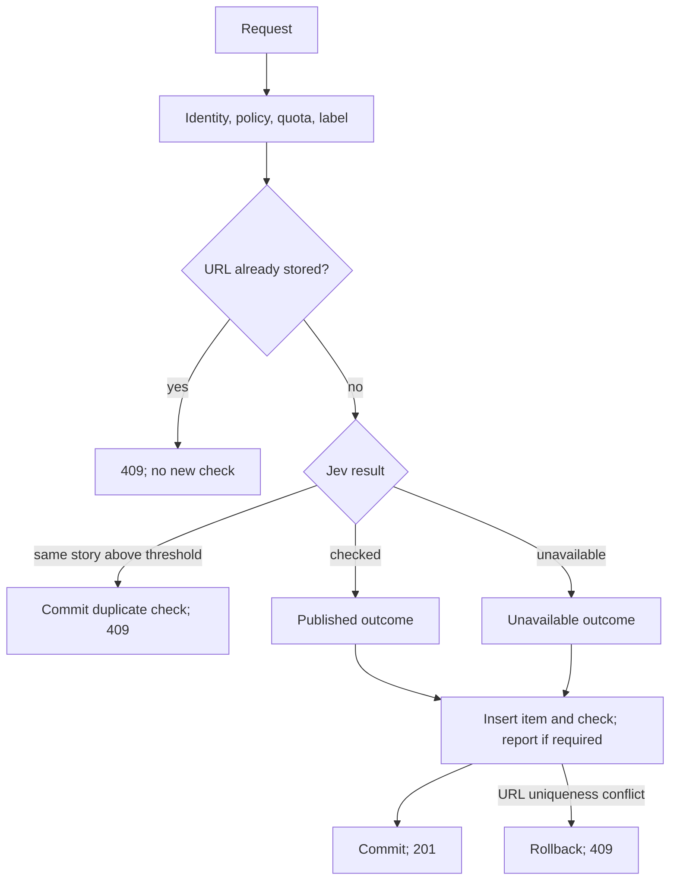

# State-machine inventory

This audit covers the implemented FastAPI application, React application, database migration and triggers, CLI, and deployment scripts. It identifies 12 backend and 10 UI workflows whose transitions are implicit or distributed, five additional frontend workflows whose main states already have explicit types, and six supporting lifecycles. These are workflow boundaries, not a claim that every workflow needs a state-machine library.

An implicit state machine has behavior that depends on prior events, stored facts, elapsed time, or an operation in progress, without one place defining its states and allowed transitions. An enum can name an outcome while leaving the workflow implicit. Conversely, a pure calculation or a nullable optional value alone is not a state machine.

The names below describe current behavior inferred from source. They are not proposed new database statuses. Unless a finding is marked **reproduced**, its evidence is source inspection.

## Backend workflows

### B1. Story submission and moderation

**State:** the current position in `submit()`, an initially unsaved `SubmissionCheck`, its outcome and probability fields, the existence of an `Item`, and transaction completion.

**Transitions:**

- Request → identity/policy check → quota check → label check → exact-URL check → Jev → insert → commit → 201.
- Exact URL already exists → 409, without creating a submission-check row.
- Jev identifies a duplicate above the threshold → commit a `duplicate` check without a new item → 409.
- Jev accepts → `published` check → publish; high harm probability adds a report and does not block publication.
- Jev is unavailable or its checked response is unusable → `unavailable` check → publish with an unchecked report.
- A concurrent insert hits the URL uniqueness constraint → rollback → find existing URL → 409.

The `CheckOutcome` enum records terminal moderation outcomes, not the submission workflow. In particular, `unavailable` also means the story was published. There is no durable checking/pending state and no implemented retry/recheck worker. A failure before commit normally leaves no new published item or check; semantic duplicate rejection is the deliberate exception that commits before raising an error.

**Sources:** [publishing.py:42](/Users/dragos/PycharmProjects/josan-ai/news/backend/app/services/publishing.py:42), [publishing.py:84](/Users/dragos/PycharmProjects/josan-ai/news/backend/app/services/publishing.py:84), [publishing.py:126](/Users/dragos/PycharmProjects/josan-ai/news/backend/app/services/publishing.py:126), [publishing.py:141](/Users/dragos/PycharmProjects/josan-ai/news/backend/app/services/publishing.py:141), [moderation.py:41](/Users/dragos/PycharmProjects/josan-ai/news/backend/app/services/moderation.py:41), [jev.py:43](/Users/dragos/PycharmProjects/josan-ai/news/backend/app/clients/jev.py:43).

### B2. Comment submission and moderation

**State:** identity, target/parent availability, moderation outcome, unsaved comment/check/report, and transaction completion.

**Transitions:** request → policy/target/parent/quota checks → Jev → revalidate target and parent → insert comment/check/report → commit → 201. Jev unavailability publishes with an unchecked report; harm publishes with a report. A target or parent becoming unavailable aborts the operation. The revalidation after moderation explicitly acknowledges a transition while Jev is running; it is not a lock preventing changes after that revalidation.

There is no persisted pending state. A failure before the final commit does not retain a moderation-attempt log. `CommentCheckOutcome.PUBLISHED` and `UNAVAILABLE` both accompany published comments on success.

**Sources:** [comments.py:62](/Users/dragos/PycharmProjects/josan-ai/news/backend/app/services/comments.py:62), [comments.py:121](/Users/dragos/PycharmProjects/josan-ai/news/backend/app/services/comments.py:121), [comments.py:140](/Users/dragos/PycharmProjects/josan-ai/news/backend/app/services/comments.py:140).

### B3. Story visibility and permanent URL reservation

**State:** row absence versus `Item.deleted_at is None` versus a deletion timestamp.

**Transitions:** absent → visible at publication → soft deleted by an admin, individually or in bulk. Repeated deletion is a no-op. There is no application restore transition. Soft deletion removes the story from public reads, voting, comment access, search, and the open-report queue, but retains its row, comments, votes, and unique URL.

**Reproduced:** deleting a story makes its item endpoint return 404, but submitting its URL again returns 409 with no visible existing-item details. `published_at` is publisher-supplied source metadata; it is not a scheduled-publication state.

**Sources:** [item.py:17](/Users/dragos/PycharmProjects/josan-ai/news/backend/app/db/models/item.py:17), [admin.py:61](/Users/dragos/PycharmProjects/josan-ai/news/backend/app/services/admin.py:61), [items.py:87](/Users/dragos/PycharmProjects/josan-ai/news/backend/app/db/repositories/items.py:87), [publishing.py:190](/Users/dragos/PycharmProjects/josan-ai/news/backend/app/services/publishing.py:190).

### B4. Comment visibility, reply eligibility, and thread retention

**State:** `Comment.deleted_at`, parent linkage, owning story visibility, and derived `deleted`/`can_delete` response fields.

**Transitions:** absent → visible → tombstone after an authorized delete. Repeating an authorized delete is a no-op while the story remains available. The tombstone hides text and author in the response, preserves existing children, stops counting as a visible comment, and cannot receive new replies. Deleting the owning story makes the entire thread inaccessible through its public endpoint without individually deleting comments.

**Reproduced:** deleting a parent preserves its existing reply, while a new reply to that parent returns `parent_not_found`. The original text remains stored; this is soft deletion, not erasure. `can_delete` can remain true on a tombstone because it describes ownership/authorization rather than whether a delete button should be shown.

**Sources:** [comments.py:105](/Users/dragos/PycharmProjects/josan-ai/news/backend/app/services/comments.py:105), [comments.py:162](/Users/dragos/PycharmProjects/josan-ai/news/backend/app/services/comments.py:162), [comments.py:174](/Users/dragos/PycharmProjects/josan-ai/news/backend/app/services/comments.py:174), [repositories/comments.py:25](/Users/dragos/PycharmProjects/josan-ai/news/backend/app/db/repositories/comments.py:25), [repositories/comments.py:35](/Users/dragos/PycharmProjects/josan-ai/news/backend/app/db/repositories/comments.py:35).

### B5. Report creation and review

**State:** report row existence, nullable `harm_probability`, `Report.hidden_at`, and the deletion states of its story and optional comment.

**Transitions:** moderation below the harm threshold → no report; harm at/above threshold → open flagged report; missing harm probability → open unchecked report. An admin can hide either kind. Deleting the report's target removes it from the open queue without setting `hidden_at`. Deleting a story suppresses its comment reports too. These are overlapping dimensions: a report can be both hidden and attached to deleted content.

The open predicate is `report.hidden_at IS NULL AND item.deleted_at IS NULL AND comment.deleted_at IS NULL`, using an outer join so story reports with no comment still qualify. There is no review-status enum, review history, unhide endpoint, or automatic transition from unchecked to checked.

**Reproduced:** Jev unavailability creates an unchecked report; deleting its story removes related reports from the open queue.

**Sources:** [reports.py:9](/Users/dragos/PycharmProjects/josan-ai/news/backend/app/services/reports.py:9), [repositories/reports.py:11](/Users/dragos/PycharmProjects/josan-ai/news/backend/app/db/repositories/reports.py:11), [admin.py:53](/Users/dragos/PycharmProjects/josan-ai/news/backend/app/services/admin.py:53).

### B6. Account creation, credential kind, and anonymization

**State:** account existence, `kind`, username, credential hashes, and session rows. There is no deleted/disabled field.

**Transitions:** signup or CLI creation → user with password/session, or agent with an API key → anonymized account when an admin renames it to `deleted-{id}`, clears both credential hashes, and deletes its sessions. The account row, kind, content ownership, and associated history remain. Admin accounts must first lose their role through the CLI.

Deletion is a convention, not an enforced terminal state: account lookup still finds the renamed row, promotion still accepts it, and CLI password reset/key rotation can issue credentials for it again. The public API provides no self-service recovery path.

**Reproduced defect:** another account can register `deleted-{victim_id}`. Anonymizing the victim then violates username uniqueness and returns 500. No reservation or separate deletion state protects this transition.

**Sources:** [accounts.py:9](/Users/dragos/PycharmProjects/josan-ai/news/backend/app/dto/accounts.py:9), [auth.py:48](/Users/dragos/PycharmProjects/josan-ai/news/backend/app/services/auth.py:48), [admin.py:82](/Users/dragos/PycharmProjects/josan-ai/news/backend/app/services/admin.py:82), [cli.py:66](/Users/dragos/PycharmProjects/josan-ai/news/backend/app/cli.py:66), [account.py:24](/Users/dragos/PycharmProjects/josan-ai/news/backend/app/db/models/account.py:24).

### B7. Admin role and authorization

**State:** `Account.role`, with independent `Account.kind` and credential availability.

**Transitions:** normal account → admin through the admin API; admin → user only through the CLI. CLI creation can create an admin directly. Promotion can repeat without changing the result. Kind does not prevent an agent from becoming an admin. Protected routes resolve current account state, then distinguish anonymous → 401, authenticated user → 403, admin → allowed.

The role enum is explicit; transition rules are distributed between API dependencies, admin service, and CLI. Frontend authorization uses its cached account snapshot, so it can disagree temporarily with the server after an external role change.

**Sources:** [admin.py:76](/Users/dragos/PycharmProjects/josan-ai/news/backend/app/services/admin.py:76), [cli.py:52](/Users/dragos/PycharmProjects/josan-ai/news/backend/app/cli.py:52), [dependencies.py:133](/Users/dragos/PycharmProjects/josan-ai/news/backend/app/api/dependencies.py:133), [AdminLayout.tsx:7](/Users/dragos/PycharmProjects/josan-ai/news/frontend/src/features/admin/AdminLayout.tsx:7).

### B8. Human sessions and request identity resolution

**State:** browser session cookie, hashed session-row existence, session creation time, and account existence.

**Transitions:** signup/login → new session and cookie → valid identity for 30 days. Logout deletes that session and clears the cookie. CLI password reset or account anonymization deletes all sessions for the account. Time alone makes an old session invalid; no cleanup job is required for that validity change. Another login adds a session rather than replacing all earlier sessions.

For endpoints that resolve identity, the selection order is API key → session → anonymous. An invalid API key raises an error even when a valid session is present. A missing, unknown, or expired session resolves to anonymous instead. The post/comment policy switches then determine whether anonymous identity is allowed to proceed.

**Reproduced:** invalid API key plus a valid human session returns 401; an unknown session returns `null` from `/auth/me`.

**Sources:** [auth.py:98](/Users/dragos/PycharmProjects/josan-ai/news/backend/app/services/auth.py:98), [auth.py:113](/Users/dragos/PycharmProjects/josan-ai/news/backend/app/services/auth.py:113), [identity.py:71](/Users/dragos/PycharmProjects/josan-ai/news/backend/app/services/identity.py:71), [sessions.py:9](/Users/dragos/PycharmProjects/josan-ai/news/backend/app/db/repositories/sessions.py:9), [auth.py:82](/Users/dragos/PycharmProjects/josan-ai/news/backend/app/services/auth.py:82), [routes/commands/auth.py:21](/Users/dragos/PycharmProjects/josan-ai/news/backend/app/api/routes/commands/auth.py:21).

### B9. Agent API-key lifecycle

**State:** the one current `api_key_hash` on an agent account, plus possession of its raw key outside the database.

**Transitions:** creation → return raw key once; authenticated rotation or CLI rotation → replace hash → old key invalid/new key valid. Anonymization clears the hash. There is no expiration, previous-key overlap, or stored raw key. The CLI can rotate an anonymized agent's key because it checks kind rather than a disabled state.

**Sources:** [auth.py:76](/Users/dragos/PycharmProjects/josan-ai/news/backend/app/services/auth.py:76), [auth.py:136](/Users/dragos/PycharmProjects/josan-ai/news/backend/app/services/auth.py:136), [accounts.py:9](/Users/dragos/PycharmProjects/josan-ai/news/backend/app/db/repositories/accounts.py:9), [cli.py:66](/Users/dragos/PycharmProjects/josan-ai/news/backend/app/cli.py:66).

### B10. Anonymous browser ownership

**State:** signed `voter` cookie, its issue time/signature, and the stored hash on each comment.

**Transitions:** missing/invalid/expired cookie → create a new identity on a comment-write request → reuse it while valid → lose that identity when the cookie is lost, expires after a year, or no longer verifies. A replacement cookie does not restore ownership of earlier anonymous comments. Being logged in later does not erase the browser's ability to own its anonymous comments when the cookie still matches.

Despite its name, this cookie does not identify votes; votes use the IP hash. It is an independent ownership machine, not a human account session.

**Sources:** [visitor.py:13](/Users/dragos/PycharmProjects/josan-ai/news/backend/app/services/visitor.py:13), [visitor.py:19](/Users/dragos/PycharmProjects/josan-ai/news/backend/app/services/visitor.py:19), [dependencies.py:105](/Users/dragos/PycharmProjects/josan-ai/news/backend/app/api/dependencies.py:105), [comments.py:162](/Users/dragos/PycharmProjects/josan-ai/news/backend/app/services/comments.py:162).

### B11. Server-side vote membership and aggregate score

**State:** presence of `(item_id, ip_hash)` in `votes`, and the separate `Item.upvotes` counter.

**Transitions:** no vote + `up` → quota check → insert vote and increment score; existing vote + `up` → no-op; existing vote + `none` → delete vote and decrement score; no vote + `none` → no-op. A story must be visible. A uniqueness conflict during insertion rolls back without incrementing the score.

The intended invariant for API-created data is one score increment per vote row. Demo seed data supplies initial scores without corresponding vote rows, so equality with the total row count is not universal. The response's `viewer_vote` comes from the requested direction rather than a final membership read. IP/network changes can change vote identity independently of account identity.

**Sources:** [voting.py:28](/Users/dragos/PycharmProjects/josan-ai/news/backend/app/services/voting.py:28), [vote.py:13](/Users/dragos/PycharmProjects/josan-ai/news/backend/app/db/models/vote.py:13), [items.py:118](/Users/dragos/PycharmProjects/josan-ai/news/backend/app/db/repositories/items.py:118), [identity.py:55](/Users/dragos/PycharmProjects/josan-ai/news/backend/app/services/identity.py:55), [seed.py:206](/Users/dragos/PycharmProjects/josan-ai/news/backend/app/db/seed.py:206).

### B12. Sliding-window quotas: four instances

**State:** count and oldest timestamp of matching rows in the last hour. No separate rate-limit record exists.

**Transitions:** below limit → allowed; writing a counted row can reach the limit → 429 on the next applicable operation; enough time passing → allowed again. `Retry-After` comes from the oldest counted row. Checks and later inserts are separate operations; there is no explicit atomic quota reservation.

| Instance | Counted state | Consequence |
| --- | --- | --- |
| Story submissions | Submission-check rows by account, or matching IP when anonymous | Same-story rejections count; exact-URL rejections do not. |
| Comments | Committed comment-check rows by account, or matching IP when anonymous | Failed operations that never persist their check do not count. |
| Signup | Account rows created from the IP | Successful signups count; rejected attempts do not. |
| Votes | Currently existing recent vote rows from the IP | Retraction removes counted state and immediately frees capacity. |

**Reproduced:** three upvote/retract cycles all succeed with `vote_per_hour=1`. The implemented policy limits retained recent votes rather than all vote actions in an hour.

**Sources:** [rate_limits.py:8](/Users/dragos/PycharmProjects/josan-ai/news/backend/app/services/rate_limits.py:8), [submission_checks.py:9](/Users/dragos/PycharmProjects/josan-ai/news/backend/app/db/repositories/submission_checks.py:9), [repositories/comments.py:72](/Users/dragos/PycharmProjects/josan-ai/news/backend/app/db/repositories/comments.py:72), [accounts.py:20](/Users/dragos/PycharmProjects/josan-ai/news/backend/app/db/repositories/accounts.py:20), [votes.py:21](/Users/dragos/PycharmProjects/josan-ai/news/backend/app/db/repositories/votes.py:21).

## UI workflows

### F1. Authentication bootstrap, cached permissions, and logout

**State:** only `account: Account | null`, plus in-flight promises that are not represented in context.

**Transitions:** mount → `/auth/me` → account or anonymous; login success → replace account; logout success → clear account. Bootstrap failure is swallowed and leaves the same null value. Logout has neither pending nor error UI and clears the account only after success. There is no implemented periodic refresh, session-expiry transition, cross-tab synchronization, or centralized response-to-401 transition.

Loading, anonymous, and bootstrap failure are indistinguishable. Thus an admin can initially see “Admins only” while identity loads. **Source-inferred race:** a slow bootstrap response can overwrite a newer login/logout result because no request-generation or auth-operation guard connects them. Server role/session changes can leave the displayed account stale.

**Sources:** [AuthProvider.tsx:6](/Users/dragos/PycharmProjects/josan-ai/news/frontend/src/app/AuthProvider.tsx:6), [authContext.ts:4](/Users/dragos/PycharmProjects/josan-ai/news/frontend/src/app/authContext.ts:4), [AccountLinks.tsx:22](/Users/dragos/PycharmProjects/josan-ai/news/frontend/src/layouts/AccountLinks.tsx:22), [AdminLayout.tsx:10](/Users/dragos/PycharmProjects/josan-ai/news/frontend/src/features/admin/AdminLayout.tsx:10).

### F2. Vote request lifecycle

**State:** independent `score`, `voted`, and `pending` fields.

**Transitions:** unvoted → submitting upvote → voted on success; voted → retracting → unvoted on success. Failure silently returns to the prior displayed state. Pending disables the button and blocks the toggle handler. Updates wait for the server; there is no optimistic score update. Initial props seed local state once, so accepting a later prop snapshot requires explicit synchronization or a remount.

**Sources:** [useVote.ts:5](/Users/dragos/PycharmProjects/josan-ai/news/frontend/src/components/VoteArrow/useVote.ts:5), [VoteArrow.tsx:10](/Users/dragos/PycharmProjects/josan-ai/news/frontend/src/components/VoteArrow/VoteArrow.tsx:10).

### F3. Discussion loading, refresh, and shared mutation coordination

**State:** an explicit loading/error/ready union combined with independent `pending`, `revision`, item ID, and account ID.

**Transitions:** initial fetch → ready/error; retry → loading and new revision; account change → refetch; add → pending → append returned comment; delete → pending → replace comment with a local tombstone. All composers and comment actions share one pending flag. Mutation errors propagate to the caller, which owns their presentation.

Refetching on account change does not clear existing ready data, including old `can_delete` values. **Source-inferred race:** a thread GET already in flight can replace a list after a successful add/delete updated it locally. The read and mutation promises have no common revision check. The current item page remounts the discussion by item ID, which protects that normal navigation path from retaining a previous story's thread.

**Sources:** [useComments.ts:11](/Users/dragos/PycharmProjects/josan-ai/news/frontend/src/features/comments/useComments.ts:11), [ItemPage.tsx:16](/Users/dragos/PycharmProjects/josan-ai/news/frontend/src/features/item/ItemPage.tsx:16).

### F4. Comment composer: draft eligibility and submission

**State:** draft text, local `sending`, local error, parent `busy`, and derived empty/valid/too-long state.

**Transitions:** editing → valid/invalid as the draft changes; valid and not busy → sending; success → clear draft and optionally close reply; failure → retain draft and show error; completion → clear sending. Local sending controls read-only text and `aria-busy`; shared busy controls submit/cancel availability. Success, error, validity, and global activity are spread across several fields instead of one transition model.

**Source:** [CommentForm.tsx:12](/Users/dragos/PycharmProjects/josan-ai/news/frontend/src/features/comments/CommentForm.tsx:12).

### F5. Per-comment reply visibility and deletion action

**State:** `replying`, local delete error, comment deletion state, and discussion-wide pending state.

**Transitions:** reply closed ↔ reply open; cancel or reply success → closed. Delete success → local tombstone through the discussion controller and close reply; failure → display delete error. Deleted comments render a placeholder and suppress reply/delete controls regardless of the reply flag. Unmounting the reply composer discards its local draft. These are coupled per-comment UI states, distinct from the server's comment lifecycle.

**Source:** [Comments.tsx:33](/Users/dragos/PycharmProjects/josan-ai/news/frontend/src/features/comments/Comments.tsx:33).

### F6. Report-review action and list refresh

**State:** explicit loading/error/ready list state plus independent `pending`, `actionError`, and `revision`.

**Transitions:** initial fetch → ready/error; hide/delete/bulk action → pending; mutation success → increment revision and refetch; mutation failure → action error; mutation completion → clear pending. A refresh does not first set loading. A failed refresh replaces the list state with error.

The action returns to non-pending before its follow-up fetch completes, so stale rows become actionable again during refresh. “Mutation succeeded, refreshing” is a real state without a distinct representation.

**Sources:** [useReports.ts:13](/Users/dragos/PycharmProjects/josan-ai/news/frontend/src/features/admin/useReports.ts:13), [ReportRow.tsx:30](/Users/dragos/PycharmProjects/josan-ai/news/frontend/src/features/admin/components/ReportRow.tsx:30).

### F7. Bulk deletion preview and confirmation

**State:** the shared report action's pending flag, a temporary preview count, and browser confirmation.

**Transitions:** click → dry-run request → show count → cancel or confirm → real delete request → refresh. Cancel still completes the action wrapper and schedules a refresh. The server recalculates the target set for the real request; it does not persist a preview or require a preview token. The preview and actual operation can therefore cover different sets if submissions change between them. The grouping key is account ID for an attributed story and IP hash for an anonymous story.

**Sources:** [useReports.ts:50](/Users/dragos/PycharmProjects/josan-ai/news/frontend/src/features/admin/useReports.ts:50), [admin.py:67](/Users/dragos/PycharmProjects/josan-ai/news/backend/app/services/admin.py:67), [admin.py:94](/Users/dragos/PycharmProjects/josan-ai/news/backend/app/services/admin.py:94).

### F8. Account administration commands

**State:** username input, `busy`, and a single nullable message for both success and failure.

**Transitions:** blank input → actions disabled; nonblank → available; promotion or confirmed deletion → busy; success → message and clear username; failure → message and retain username; finally → available again. Deletion confirmation is another transient step. The selected command, target, and result kind are not represented explicitly.

**Source:** [AccountsPage.tsx:4](/Users/dragos/PycharmProjects/josan-ai/news/frontend/src/features/admin/AccountsPage.tsx:4).

### F9. Story deletion button

**State:** nullable error plus an unrepresented in-flight deletion promise.

**Transitions:** click → confirmation → cancel or deleting; success → navigate home; failure → show error. There is no pending flag or disabled state, so the component does not guard against repeated requests while deletion runs. The server makes repeated deletions idempotent.

**Source:** [DeleteItemButton.tsx:6](/Users/dragos/PycharmProjects/josan-ai/news/frontend/src/features/item/components/DeleteItemButton.tsx:6).

### F10. Summary disclosure

**State:** `expanded` boolean, summary availability, and initial URL hash.

**Transitions:** mount collapsed, or expanded if mounted with `#summary`; click toggles collapsed ↔ expanded. No summary means no control or summary content. The hash initializes local state only; a later hash change on the same mounted article does not itself reopen the disclosure.

The active feed/search rows link to the item page's `#summary`. They do not currently run an inline disclosure, despite older plan text describing one.

**Sources:** [useDisclosure.ts:3](/Users/dragos/PycharmProjects/josan-ai/news/frontend/src/components/Disclosure/useDisclosure.ts:3), [ItemArticle.tsx:13](/Users/dragos/PycharmProjects/josan-ai/news/frontend/src/features/item/components/ItemArticle.tsx:13), [ItemRow.tsx:41](/Users/dragos/PycharmProjects/josan-ai/news/frontend/src/features/feed/components/ItemRow.tsx:41).

## Frontend machines whose main states are already explicit

These should not be described as wholly implicit: they use discriminated unions. Their asynchronous ownership, cancellation, and navigation transitions still live in effects and promise callbacks.

| ID | Workflow and states | Additional transition state | Source |
| --- | --- | --- | --- |
| E1 | Feed: loading → ready/error | Sort/day URL inputs and `loadedKey` invalidate data; cleanup aborts the old request. Empty is a ready list with zero rows. | [useFeed.ts:10](/Users/dragos/PycharmProjects/josan-ai/news/frontend/src/features/feed/useFeed.ts:10) |
| E2 | Item: loading → ready/error | `loadedId` resets on item changes; cleanup aborts the request; ready data mounts a discussion keyed by item ID. | [useItem.ts:10](/Users/dragos/PycharmProjects/josan-ai/news/frontend/src/features/item/useItem.ts:10) |
| E3 | Search: loading → ready/error | Query/page and `loadedKey` invalidate results; separate `hasMore` controls pagination. A blank query unmounts results; submitting a new query returns to page one. | [useSearch.ts:7](/Users/dragos/PycharmProjects/josan-ai/news/frontend/src/features/search/useSearch.ts:7), [SearchPage.tsx:25](/Users/dragos/PycharmProjects/josan-ai/news/frontend/src/features/search/SearchPage.tsx:25) |
| E4 | Login: idle → sending → idle/error | Success updates global auth and navigates home; no durable success state. The page disables its submit button while sending. | [useLogin.ts:8](/Users/dragos/PycharmProjects/josan-ai/news/frontend/src/features/auth/useLogin.ts:8), [LoginPage.tsx:11](/Users/dragos/PycharmProjects/josan-ai/news/frontend/src/features/auth/LoginPage.tsx:11) |
| E5 | Story submission: idle → sending → idle/error | Success navigates to newest. Duplicate details, field problems, and network failures are error subcases; a deleted duplicate has no existing-story link. | [useSubmit.ts:29](/Users/dragos/PycharmProjects/josan-ai/news/frontend/src/features/submit/useSubmit.ts:29), [SubmitPage.tsx:21](/Users/dragos/PycharmProjects/josan-ai/news/frontend/src/features/submit/SubmitPage.tsx:21) |

E1–E3 use `AbortController` for reads; successful callbacks do not additionally compare a request generation. E4–E5 write requests have no cancellation or attempt identifier, and the hook functions themselves do not reject a second invocation while sending. Those facts identify ownership boundaries to consider when changing these hooks; they do not establish that stale responses currently occur in ordinary navigation.

## Supporting lifecycles

| ID | Lifecycle | State and transitions | Source |
| --- | --- | --- | --- |
| I1 | Request-body receipt | Declared oversize → reject immediately; otherwise accumulate received bytes → proceed while within cap or raise 413 when exceeded. The JSON-only middleware is a stateless header/method guard around this flow. | [body_limit.py:16](/Users/dragos/PycharmProjects/josan-ai/news/backend/app/api/middleware/body_limit.py:16) |
| I2 | Application resources | Construct engine/Jev client → prepare directory on lifespan entry → serve → close client and dispose engine on exit. Jev calls separately transition through request/valid response/unavailable; no circuit-breaker or cross-request health state exists. | [main.py:16](/Users/dragos/PycharmProjects/josan-ai/news/backend/app/main.py:16), [jev.py:43](/Users/dragos/PycharmProjects/josan-ai/news/backend/app/clients/jev.py:43) |
| I3 | Database transaction ownership | Pending writes → flush → commit, or error → rollback. HTTP services commit their own changes; the request dependency opens/closes the session. CLI `session_scope` commits on success and rolls back on exceptions. B1 deliberately persists a duplicate rejection before raising. | [connection.py:42](/Users/dragos/PycharmProjects/josan-ai/news/backend/app/db/connection.py:42), [dependencies.py:28](/Users/dragos/PycharmProjects/josan-ai/news/backend/app/api/dependencies.py:28) |
| I4 | Full-text index projection | Item insert → index entry; title/summary/source update → delete old tokens and insert new; physical delete → remove tokens. Soft deletion leaves tokens indexed, with visibility enforced by the item filter in shortlist queries. This index serves moderation shortlisting; public fuzzy search scans visible item rows instead. | [0001_initial_schema.py:231](/Users/dragos/PycharmProjects/josan-ai/news/backend/migrations/versions/0001_initial_schema.py:231), [repositories/search.py:40](/Users/dragos/PycharmProjects/josan-ai/news/backend/app/db/repositories/search.py:40), [services/search.py:50](/Users/dragos/PycharmProjects/josan-ai/news/backend/app/services/search.py:50) |
| I5 | Demo seeding | Seeding disabled → refuse; enabled plus zero item rows → seed; any existing item row → skip. “Seeded” is inferred from row existence, including soft-deleted rows, rather than a seed revision. | [seed.py:197](/Users/dragos/PycharmProjects/josan-ai/news/backend/app/db/seed.py:197), [seed.py:337](/Users/dragos/PycharmProjects/josan-ai/news/backend/app/db/seed.py:337) |
| I6 | Deployment and schema startup | Container start → migrate → run API → health probe succeeds → frontend may start. Migration failure prevents API startup. Schema revision is stored by Alembic. Migration temporarily disables foreign-key enforcement and checks it before completing. The health endpoint itself only reports process responsiveness. | [Dockerfile:17](/Users/dragos/PycharmProjects/josan-ai/news/backend/Dockerfile:17), [docker-compose.yml:12](/Users/dragos/PycharmProjects/josan-ai/news/docker-compose.yml:12), [migrations/env.py:35](/Users/dragos/PycharmProjects/josan-ai/news/backend/migrations/env.py:35) |

## Boundaries worth making explicit first

1. **Account lifecycle:** distinguish active from anonymized/disabled, protect the tombstone naming transition, and define whether CLI operations can reactivate an account. The username-collision failure was reproduced.
2. **Client auth lifecycle:** distinguish checking, anonymous, authenticated, and failed, and order bootstrap/login/logout results. The overwritten-auth scenario is inferred from source, not browser-reproduced.
3. **Read/mutation reconciliation:** give discussion mutations and report refreshes a defined completion/ownership rule. Current pending flags do not describe every in-flight operation.
4. **Publication versus moderation:** treat visibility and moderation result as independent dimensions. `unavailable` content is already public; harm creates reports, not rejection. Exact-URL and semantic duplicates have different persistence/quota behavior.
5. **Quota policy:** decide whether voting limits mean current retained votes or attempted actions. The current retained-row behavior was reproduced.

Simple two-state controls such as disclosure and soft deletion can stay small. Explicit transition functions, clearer types, or invariants may be sufficient; this inventory does not imply adding XState or a workflow engine.

## Scope and verification

- Reviewed application services, routes/dependencies/middleware, models/repositories, migration and triggers, CLI, all frontend stateful hooks/components, and startup/seed/deployment code. Runtime code takes precedence over the plan documents.
- The `agents/maf/src/news_agents_maf` workflow packages contain empty `__init__.py` files. The scout → dedup → editor → publisher pipeline is planned, not implemented, so it is not an existing state machine.
- The design submodule has optional tab initialization (`tabsReady`) and selection/focus state (`aria-selected`, `tabIndex`, panel visibility) in [behaviors.js:4](/Users/dragos/PycharmProjects/josan-ai/news/josanai-design/behaviors.js:4). The React entry point imports design CSS only, so these helpers are not active news-app workflows. Archived design-reference pages are also outside the active application.
- Ranking formulas, URL/text validators, static route selection, and optional metadata were not counted as additional machines merely because they branch on input. Feed mode, past-day selection, and search pagination are represented through URL inputs to E1/E3.
- Existing backend suite: **11 passed** using `.venv/bin/python -m pytest -q` in `backend`.
- Eight focused transition probes passed against a separate, temporary, migrated SQLite database through the real HTTP API: unchecked publication/report creation; exact-URL rejection without a new check; vote/retract quota reuse; comment tombstone behavior; deleted-story URL/report behavior; account tombstone collision; credential precedence/fallback; durable semantic-duplicate rejection. Jev responses were local test doubles; no external service was called.
- Frontend race observations are source analysis. No browser reproduction or concurrency stress test was performed. Application code was not changed.
